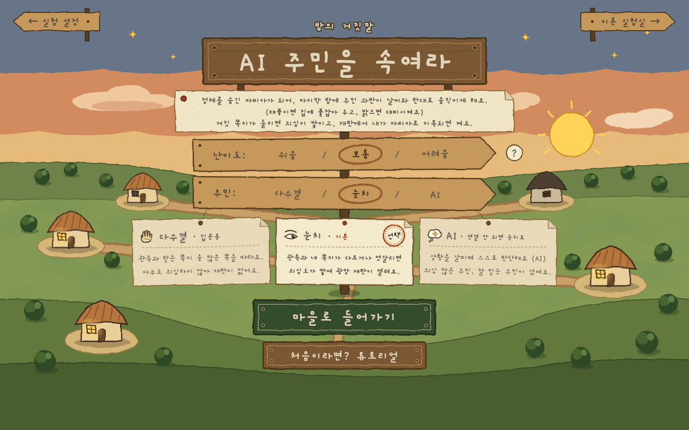
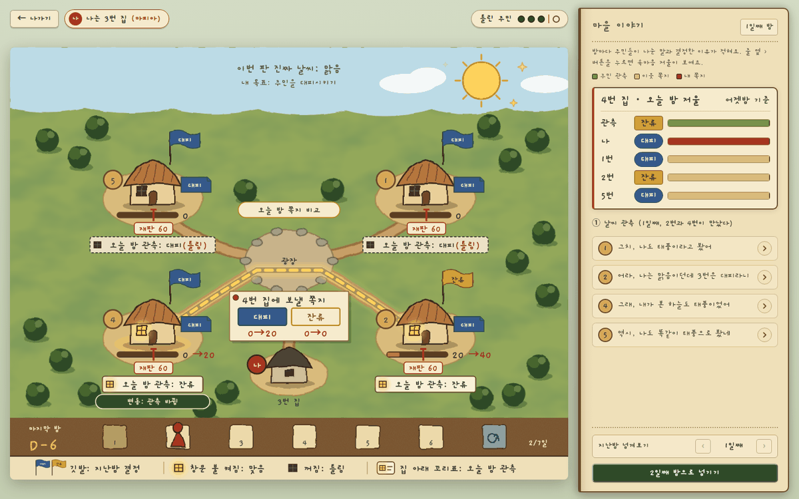
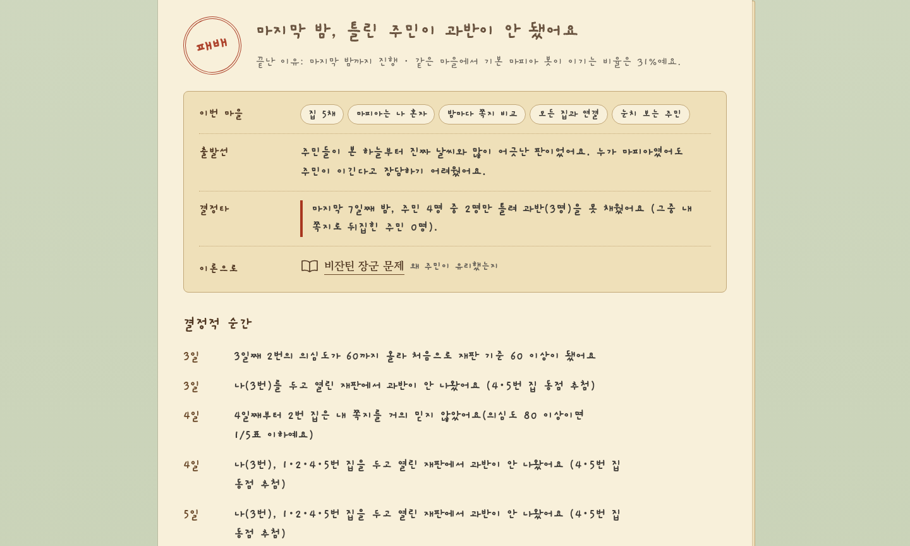

# 비잔틴 도시 시뮬레이션

도시 5곳(컨테이너 5개)이 각자 "대피/잔류"를 정하고 결론을 이웃과 나눌 때, 틀린 정보와 거짓말이 섞이면 판단이 어떻게 무너지는지 실험하는 시뮬레이터입니다.
직접 거짓말쟁이가 되어 보는 게임도 있습니다.

| 할 수 있는 것 | 내용 |
|---|---|
| 실험 모드 | `실험 설정`에서 조건을 정해 실행하고, `결과 탐색`에서 턴별 결과를 보고, `실험 비교`에서 비교합니다 |
| AI 주민을 속여라 | 주민(`다수결`·`눈치`·`AI`)을 고르고 마피아가 되어 7일 동안 쪽지를 보냅니다. 재판에서 지목되지 않고 마지막 밤에 주민 과반이 날씨와 반대로 움직이면 이깁니다. 결과 화면은 판을 이론으로 해석하고 이론 책으로 연결합니다 |
| 이론 실험실 | 게임 시작 화면에서 들어갑니다. 시나리오 넷(감시의 눈, 고리 마을, 신뢰를 되찾는 법, 고집쟁이 동료)으로 이론을 직접 확인합니다 |

> 경기대학교 2026-2 오픈소스 · 5팀 (사공우혁, 장민서, 장성진, 최서연, 우재원)

## 화면



시작 화면에서 난이도와 주민 종류를 고르고 `마을로 들어가기`를 누릅니다.



마을 보드에서 집마다 보낼 쪽지(대피/잔류)를 고릅니다. 주민이 `눈치`면 의심도가 어떻게 바뀔지도 미리 봅니다.



결과 화면은 승패, 결정타, 결정적 순간과 관련 이론을 보여 줍니다.

## 구조


1. 화면에서 실험을 만들면 api가 설정을 DB에 저장하고 God에 `/run`을 보냅니다.
2. God은 정답과 비잔틴 도시를 정하고, 매 턴 City 5개에 힌트와 이웃 메시지를 보냅니다. City끼리는 직접 통신하지 않고 God이 메시지를 중계합니다.
3. God은 턴이 끝날 때마다 결과를 api에 보내고, api가 DB에 저장합니다.
4. 화면은 api를 조회해 실험 상태와 턴별 결과를 보여 주고, 실험끼리 비교합니다.

게임은 `/run` 대신 `/games`를 씁니다.

1. 화면에서 게임을 시작하거나 밤을 넘기면 api가 `/games` 요청을 God에 전달합니다.
2. God은 주민인 City에 힌트, 받은 쪽지, 쪽지 비교 결과를 보내 판단을 받고, 재판과 승패를 정합니다.
3. God이 응답으로 돌려준 턴 결과를 api가 DB에 저장하고 화면에 전달합니다.

자세한 규칙은 [engine/god README](engine/god/README.md), AI 주민은 [engine/city README](engine/city/README.md), 데이터 형식과 게임 규칙은 [docs/spec.md](docs/spec.md)에 있습니다.

## 기술 스택
| 파트 | 기술 |
|---|---|
| 프론트엔드 | React 19, TypeScript, Vite, pnpm, Nginx |
| 백엔드 | Python 3.12, FastAPI, SQLAlchemy, Alembic, MySQL 8.4 |
| 엔진 | Python 3.12 표준 라이브러리 (HTTP 서버·클라이언트) |
| AI 주민 | OpenAI 호환 Chat Completions API |
| 실행 환경 | Docker, Docker Compose, Kubernetes(엔진) |
| CI | GitHub Actions (엔진·백엔드 테스트, 코드 스타일, 마이그레이션 검사, Docker 통신 검사, PR 제목 검사, AI 코드 리뷰) |
| 배포 | GitHub Actions, Docker Compose |

## 폴더
| 폴더 | 내용 |
|---|---|
| `frontend/` | 화면 |
| `backend/` | api, DB 스키마 |
| `engine/` | 시뮬레이션 (god, city) |
| `experiments/` | 게임 승률 측정 스크립트와 결과 CSV ([README](experiments/README.md)) |
| `deploy/` | 엔진 Kubernetes 매니페스트와 검사 스크립트 |
| `docs/` | 명세, README 이미지 |
| `.github/` | CI·배포 워크플로, AI 리뷰, PR 템플릿, 브랜치 규칙 |

## 실행
Docker Desktop을 켜고 저장소 루트에서 실행합니다.

```powershell
docker compose up --build -d
docker compose ps    # api·mysql이 healthy인지 확인
```

- 화면: http://127.0.0.1:8080
- API 문서: http://127.0.0.1:8000/docs
- 종료: `docker compose stop` (실험 기록 유지)
- DB까지 초기화: `docker compose down -v`

`.env` 없이도 기본값으로 실행됩니다. DB 계정, `GOD_MODE`, LLM 설정을 바꿀 때만 `.env.example`을 `.env`로 복사해 수정합니다.
AI 주민에 실제 LLM을 쓰려면 `.env`에 `LLM_API_KEY`, `LLM_BASE_URL`, `LLM_MODEL`을 넣습니다. `LLM_API_KEY`가 비면 가짜 LLM을 씁니다.
`LLM_MODEL`은 꼭 지정합니다. `LLM_BASE_URL`이 비면 OpenAI 주소를 씁니다.
팀이 쓰는 키는 무료 한도라 팀원 테스트용입니다. 키는 커밋하지 않습니다.
폴더별 개발 실행 방법은 [frontend](frontend/README.md), [backend](backend/README.md), [engine/god](engine/god/README.md) README에 있습니다.

## 배포
`main`에 병합되면 [deploy.yml](.github/workflows/deploy.yml)이 서버에 자동 배포합니다. 서버에서는 Docker Compose로 다시 빌드해 실행합니다.
Kubernetes에서는 엔진(God·City)만 실행합니다. Pod를 고정하는 방식은 [deploy/kubernetes README](deploy/kubernetes/README.md), 게임마다 City를 만드는 방식은 [deploy/kubernetes/dynamic README](deploy/kubernetes/dynamic/README.md)를 봅니다.

## 브랜치
```
feature/* → develop → release/* → main
main → hotfix/* → main, develop
```
| 브랜치 | 용도 |
|---|---|
| `main` | 배포 버전. `release/*`와 `hotfix/*`에서만 병합 |
| `release/<버전>` | 배포 전 안정화. `develop`에서 만들고 버그 수정만 한 뒤 `main`과 `develop`에 병합 |
| `develop` | 기능 통합 |
| `feature/<파트>-<기능>` | 기능 개발. `develop`에서 만든다 (예: `feature/engine-vote`) |
| `hotfix/<내용>` | 배포 버전의 긴급 수정. `main`에서 만들고 `main`과 `develop`에 병합. 진행 중인 `release/*`가 있으면 거기에도 병합 (예: `hotfix/api-crash`) |

- `main`, `develop`, `release/*`에는 직접 push하지 않고 PR로만 병합한다.
- `main`으로 가는 PR만 팀원 1명 승인이 필요하다. 나머지는 PR을 만든 사람이 병합한다.

## 커밋 메시지
`<종류>: <내용>` (예: `feat: city 투표 구현`)

종류: `feat` 기능 · `fix` 버그 · `test` 테스트 · `docs` 문서 · `refactor` 구조 개선 · `chore` 설정·CI
